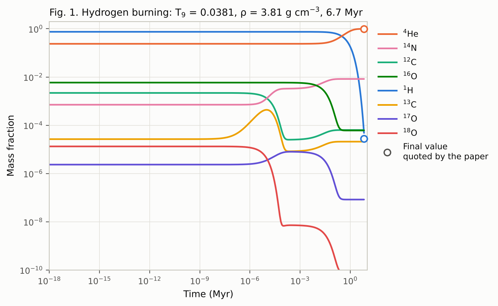
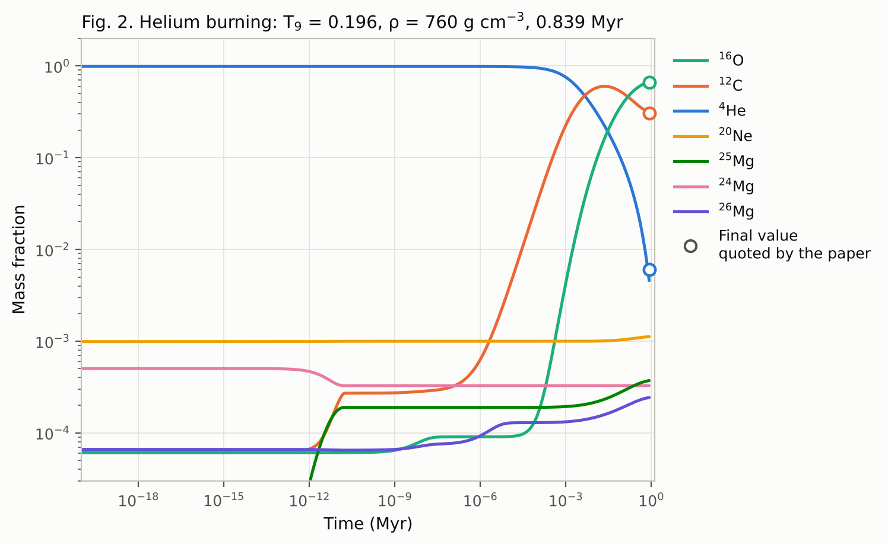
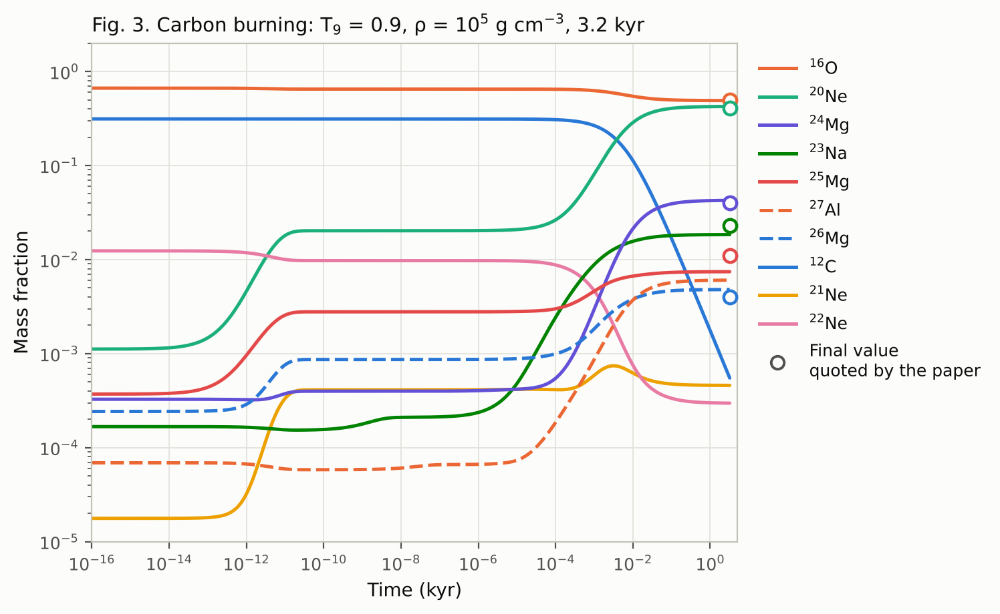
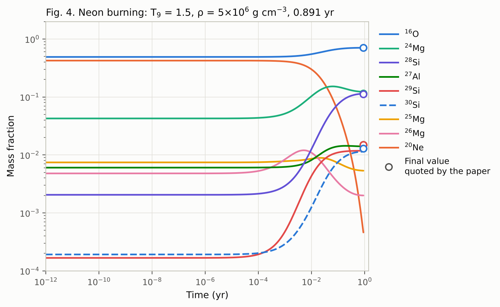
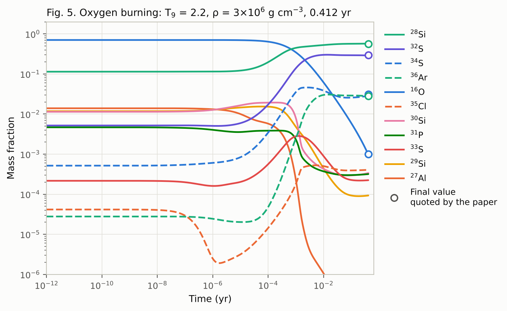
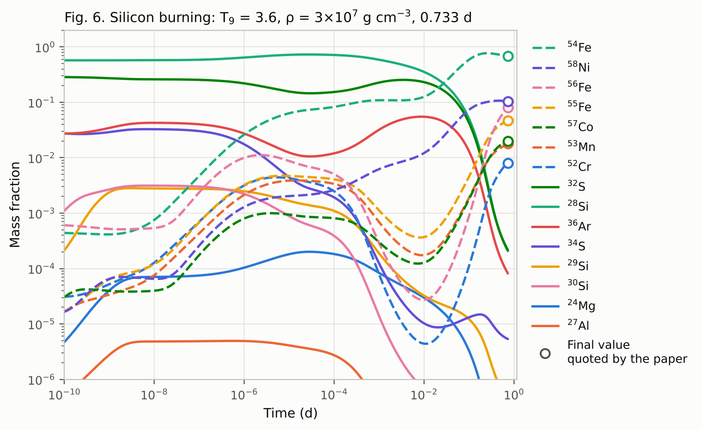
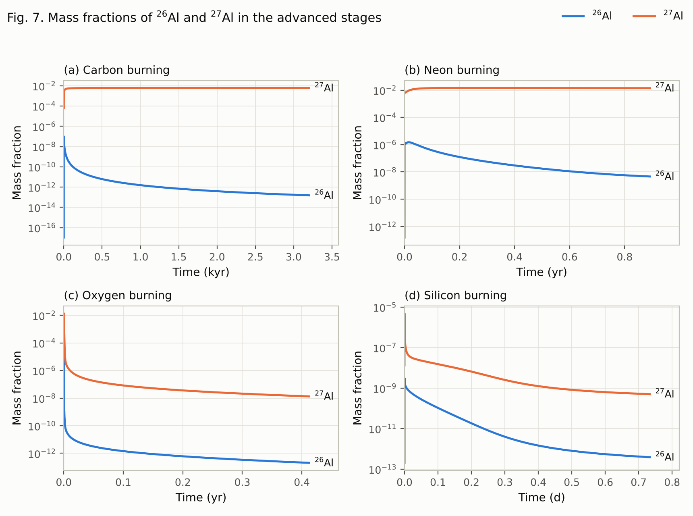
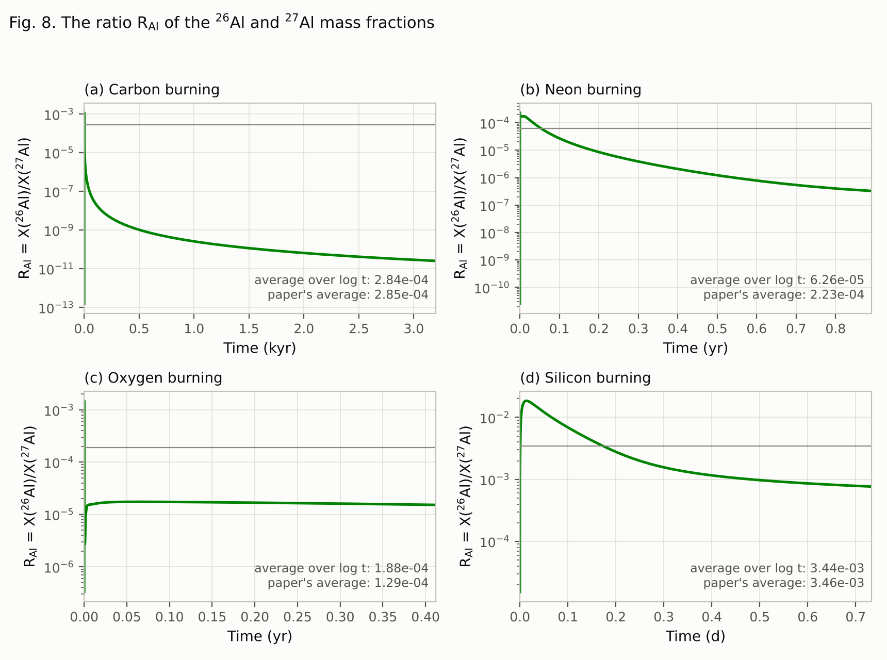
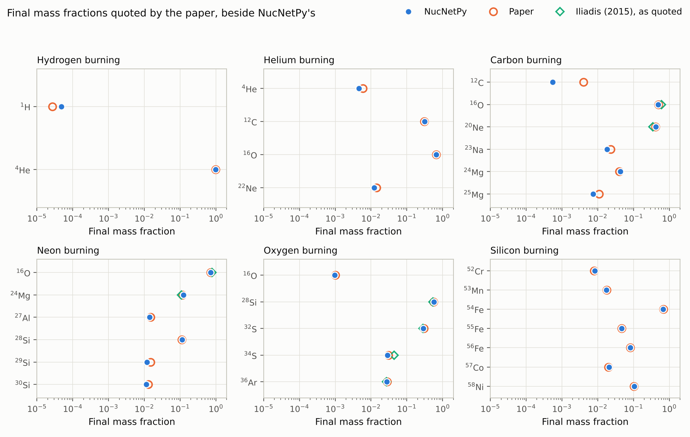

# Aluminium in massive stars: a NucNetPy reproduction

This directory redoes, with NucNetPy, every calculation and figure of

> A. I. Abdallah and N. M. Ershaidat, "A Study of the Abundance of Aluminium in
> Massive Stars", *Jordan Journal of Physics* **17** (3), 273–282 (2024),
> doi:[10.47011/17.3.2](https://doi.org/10.47011/17.3.2).

The paper used NucNet Tools. It follows the core of a 25 solar-mass star
through six burning stages. Each stage is held at a fixed temperature and
density for a fixed time, and each one starts from the composition that the
previous stage left behind. The paper pays particular attention to the two
aluminium isotopes, ²⁶Al and ²⁷Al, and to the ratio of their mass fractions,
R<sub>Al</sub> = X(²⁶Al)/X(²⁷Al).

## The result in brief

NucNetPy reproduces the paper closely. Of the 30 final mass fractions the paper
quotes, 22 agree with NucNetPy to within 10 per cent and 14 to within
3 per cent. All seven iron-group nuclides it gives for silicon burning agree to
within 4 per cent. The curves of Figs. 1–8 have the same shapes and features
as the paper's. The largest differences are in fuels that are nearly used up
by the end of their stage (hydrogen, helium and carbon), whose final values
fall so steeply that small differences in the reaction rates move them a lot.

The calculation also settles three things the paper leaves open:
- **Silicon burning lasted 0.733 days.** The paper's figures and results say
  days, while its Table 1 says years.
- **The R<sub>Al</sub> averages are averages over the logarithm of time.** The
  paper does not say how it averaged.
- **Screening was most likely left out.** The paper does not mention it.

## What is calculated

The six stages are those of the paper's Table 1.

| Stage | Temperature (GK) | Density (g cm⁻³) | Duration |
|---|---|---|---|
| Hydrogen burning | 0.0381 | 3.81 | 6.7 Myr |
| Helium burning | 0.196 | 7.6 × 10² | 0.839 Myr |
| Carbon burning | 0.9 | 1 × 10⁵ | 3.2 kyr |
| Neon burning | 1.5 | 5 × 10⁶ | 0.891 yr |
| Oxygen burning | 2.2 | 3 × 10⁶ | 0.412 yr |
| Silicon burning | 3.6 | 3 × 10⁷ | 0.733 d |

The paper's Table 1 gives 0.733 yr for silicon burning, but its Figs. 6, 7(d)
and 8(d) all run to 0.733 days, so 0.733 d is used here. A year is taken as
365.25 days.

**Nuclear network.** Every JINA ReacLib rate among the nuclides from hydrogen to
nickel (atomic number Z ≤ 28): 891 nuclides and 10,787 reactions. The rates
come from the ReacLib snapshot of 29 March 2022, as distributed with pynucastro
3.2.0. The paper was submitted on 15 March 2022 and does not say which snapshot
it used; this is the closest one available. Every reverse rate that ReacLib
derives by detailed balance is multiplied by the ratio of partition functions
that ReacLib leaves out, as NucNetPy does by default.

**Nuclear data.** Masses from the 2020 Atomic Mass Evaluation (AME2020), spins
from NUBASE2020, and partition functions from Rauscher and Thielemann (2000),
all as distributed with pynucastro. For the 279 nuclides near the drip lines
that AME2020 does not list, the mass is worked out from a ReacLib Q value.
These masses do not enter the calculation, which uses fitted rates, but a
nuclide file needs one.

**Initial composition.** The solar composition of Lodders (2003, ApJ 591, 1220),
isotope by isotope, as tabulated in the file `sollo03.dat` of the StarFit
package. Hydrogen, helium and the heavier elements are each scaled to the
present-day photospheric totals that the paper quotes (X = 0.7491, Y = 0.2377,
Z = 0.0133). Those totals add up to 1.0001 because of rounding, so the whole
composition is then divided by 1.0001.

**Integration.** Implicit (backward) Euler steps solved by Newton–Raphson
iterations, the scheme NucNet Tools uses (`stepper.py`). Each step is sized so
that no mass fraction above 10⁻¹⁵ changes by more than 0.5 per cent. The
next section explains why NucNetPy's own integrator, `evolve_zone`, could not
be used. Results are recorded at 300 times per stage, spaced evenly in the
logarithm of time from the start of the paper's time axis.

The equations integrated are NucNetPy's. Within a stage the temperature and
density are fixed, so every rate is a constant: `fastnet.py` asks NucNetPy for
each of the 10,787 rates once, through `Reaction.rate`, and then evaluates
NucNetPy's flow formula for all of them at once with sparse matrices. In the
conditions of all six stages, with and without screening, this reproduces
`nucnetpy.solver.rhs` and `nucnetpy.solver.analytic_jacobian` to 6 × 10⁻¹⁵,
about a hundred times faster. In a test run of hydrogen burning, the stepper
gave the same final mass fractions to 4 × 10⁻¹² whether it used `fastnet.py`
or NucNetPy's own two functions (`stepper.evolve(..., fast=False)`).

**Accuracy.** Implicit Euler is first-order accurate: halving the step halves
the error. Hydrogen burning was also integrated with SciPy's BDF method at a
relative tolerance of 10⁻⁶, which succeeds for that stage in a copy of
NucNetPy whose right-hand side does not clip negative abundances (see below).
Against it, the final
hydrogen abundance, which falls steeply as the stage ends, is 1.0 per cent
high, and ²⁵Mg, which is almost entirely burnt, 0.9 per cent; every other
mass fraction above 10⁻¹² agrees to 0.03 per cent. A second run with steps
twice as large (`results_check/`) differs from the main run by as much as the
main run differs from the BDF result, so the difference between the two runs
measures the error of the main run in every stage.

**Screening.** The paper does not mention electron screening, so the main
calculation leaves it out. A second run with NucNetPy's SkyNet screening is in
`results_screened/`, to show how much it matters.

## Results

### Final mass fractions

*Ratio* is NucNetPy divided by the paper. *Screened* is the run with SkyNet
screening. The last column gives the values the paper quotes from Iliadis,
*Nuclear Physics of Stars* (2015). The full table, with the ten most abundant
nuclides after each stage, is in `results/comparison.md`.

| Stage | Nuclide | Paper | NucNetPy | Ratio | Screened | Iliadis |
|---|---|---|---|---|---|---|
| Hydrogen | ¹H | 2.73 × 10⁻⁵ | 4.83 × 10⁻⁵ | 1.77 | 4.27 × 10⁻⁵ | |
| | ⁴He | 0.985 | 0.987 | 1.00 | 0.987 | |
| Helium | ⁴He | 0.006 | 0.00457 | 0.76 | 0.00416 | |
| | ¹²C | 0.3075 | 0.3132 | 1.02 | 0.3125 | |
| | ¹⁶O | 0.6671 | 0.6649 | 1.00 | 0.666 | |
| | ²²Ne (see below) | 0.0141 | 0.0124 | 0.88 | 0.0124 | |
| Carbon | ¹²C | 0.004 | 0.00055 | 0.14 | 0.00049 | |
| | ¹⁶O | 0.497 | 0.4906 | 0.99 | 0.4935 | 0.600 |
| | ²⁰Ne | 0.409 | 0.4245 | 1.04 | 0.4219 | 0.350 |
| | ²³Na | 0.023 | 0.0184 | 0.80 | 0.0184 | |
| | ²⁴Mg | 0.040 | 0.0426 | 1.07 | 0.0424 | |
| | ²⁵Mg | 0.011 | 0.0074 | 0.68 | 0.0075 | |
| Neon | ¹⁶O | 0.708 | 0.7059 | 1.00 | 0.7064 | 0.770 |
| | ²⁴Mg | 0.115 | 0.1229 | 1.07 | 0.1184 | 0.110 |
| | ²⁷Al | 0.015 | 0.0140 | 0.93 | 0.0133 | |
| | ²⁸Si | 0.112 | 0.1141 | 1.02 | 0.1164 | |
| | ²⁹Si | 0.015 | 0.0118 | 0.79 | 0.0117 | |
| | ³⁰Si | 0.013 | 0.0114 | 0.88 | 0.0117 | |
| Oxygen | ¹⁶O | 0.001 | 0.00098 | 0.98 | 0.00064 | |
| | ²⁸Si | 0.565 | 0.5728 | 1.01 | 0.5692 | 0.54 |
| | ³²S | 0.299 | 0.2894 | 0.97 | 0.2895 | 0.280 |
| | ³⁴S | 0.031 | 0.0287 | 0.93 | 0.0283 | 0.044 |
| | ³⁶Ar | 0.028 | 0.0279 | 0.99 | 0.0288 | 0.027 |
| Silicon | ⁵²Cr | 0.008 | 0.00834 | 1.04 | 0.00765 | |
| | ⁵³Mn | 0.018 | 0.0177 | 0.98 | 0.0167 | |
| | ⁵⁴Fe | 0.683 | 0.6797 | 1.00 | 0.6676 | |
| | ⁵⁵Fe | 0.047 | 0.0471 | 1.00 | 0.0469 | |
| | ⁵⁶Fe | 0.081 | 0.0821 | 1.01 | 0.0829 | |
| | ⁵⁷Co | 0.020 | 0.0206 | 1.03 | 0.0217 | |
| | ⁵⁸Ni | 0.103 | 0.1043 | 1.01 | 0.1153 | |

### Figures

The figures redraw the paper's Figs. 1–8 with the same nuclides, units and
axes. In Figs. 1–6 an open circle at the end of each stage marks a final value
quoted in the paper's text. Fig. 9, not in the paper, sets every quoted value
beside NucNetPy's.

| | |
|---|---|
|  |  |
|  |  |
|  |  |
|  |  |



### The aluminium ratio

R<sub>Al</sub> = X(²⁶Al)/X(²⁷Al) behaves as in the paper's Figs. 7 and 8:
- **Carbon and neon burning:** it falls through most of the stage.
- **Oxygen burning:** it stays flat near 1.5 × 10⁻⁵.
- **Silicon burning:** it rises to about 2 × 10⁻² within the first hundredth
  of a day and then falls.

The paper gives one average for each stage without saying how it was formed.
Averaged over time, NucNetPy's ratio is far below the paper's values.
Averaged over the logarithm of time instead, it matches them for carbon and
silicon burning to within 1 per cent. That is what a plain mean over output
steps amounts to when the steps grow geometrically, as NucNet Tools' time
steps usually do:

| Stage | Paper | Average over log time | Average over time | At the end |
|---|---|---|---|---|
| Carbon | 2.85 × 10⁻⁴ | 2.84 × 10⁻⁴ | 9.0 × 10⁻⁸ | 2.5 × 10⁻¹¹ |
| Neon | 2.23 × 10⁻⁴ | 6.3 × 10⁻⁵ | 1.3 × 10⁻⁵ | 3.3 × 10⁻⁷ |
| Oxygen | 1.29 × 10⁻⁴ | 1.88 × 10⁻⁴ | 1.7 × 10⁻⁵ | 1.5 × 10⁻⁵ |
| Silicon | 3.46 × 10⁻³ | 3.44 × 10⁻³ | 3.2 × 10⁻³ | 7.7 × 10⁻⁴ |

For neon and oxygen burning the log-time averages differ from the paper's by
factors of 3.6 and 1.5. Such an average depends on where the output steps
begin, which the paper does not give. The abstract's overall value,
1.68 × 10⁻⁴, could not be reproduced: none of the usual ways of combining the
four stage values gives it.

### Where NucNetPy and the paper differ, and why

- **Silicon burning lasts 0.733 days, not years.** The paper's Table 1 says
  0.733 yr, but its Figs. 6, 7(d) and 8(d) run to 0.733 d. Run for 0.733 days,
  NucNetPy reproduces every iron-group value the paper quotes to within
  4 per cent. Weak decays of proton-rich nuclei lower the electron fraction
  Y<sub>e</sub> from 0.498 to 0.479 in that time. Run for 0.733 years
  (`results_silicon_year/`), they lower it to 0.465 and carry the core on to
  ⁵⁶Fe (0.76), with only 0.02 of ⁵⁴Fe and 0.003 of ⁵⁸Ni.
- **"²⁰Ne (0.0141)" after helium burning is ²²Ne.** The paper's own Fig. 2
  keeps ²⁰Ne near 0.001, and its Fig. 3 starts carbon burning with ²²Ne at
  about 0.014. ²²Ne inherits all the initial carbon, nitrogen and oxygen
  through ¹⁴N, so its value depends on the CNO content of the starting
  composition.
- **Fuels near exhaustion.** The final abundances of hydrogen, helium and
  carbon after their own burning stages (ratios 1.77, 0.76 and 0.14) fall
  steeply at the end of each stage, so a small difference in a rate between
  ReacLib versions, or in the starting composition, shifts them a lot. The
  same holds for ²⁵Mg after carbon burning. Oxygen after oxygen burning is
  the exception: it agrees to within 3 per cent.
- **Other nuclides after oxygen burning.** The paper says that every
  nuclide other than those it lists stays below 10⁻³. But the five it lists
  add up to only 0.924 of the mass. NucNetPy puts most of the remainder in
  ³⁸Ar (0.054) and ⁴⁰Ca (0.021).
- **³²S after oxygen burning** is given as 0.299 in the text and 0.290 in the
  caption of Fig. 5. NucNetPy gives 0.289.
- **Screening.** With screening, the two values most affected move away from
  the paper: oxygen after oxygen burning (6.4 × 10⁻⁴ against the paper's
  0.001) and ⁵⁸Ni after silicon burning (0.115 against 0.103). Without
  screening both agree, so the paper's calculation most likely did not
  include it either.

### Numerical checks

- **Mass conservation:** the mass fractions add up to one within 4 × 10⁻¹⁴ in
  the first five stages and within 10⁻⁸ in silicon burning.
- **Step size:** the run with steps twice as large (`results_check/`) differs
  from the main run by at most 1.0 per cent on any value the paper quotes
  (hydrogen after hydrogen burning), and by at most 1.4 per cent on any final
  mass fraction above 10⁻¹².
- **Run time:** on one processor core, the main run takes 35 minutes, the
  check 21 minutes, the screened run 34 minutes, and silicon burning for
  0.733 years 21 minutes.

## How to reproduce

Python 3.9 or later, NumPy, SciPy and, for the figures, matplotlib:

```bash
git clone https://github.com/mtalafha90/NucNetPy.git
cd NucNetPy
git checkout claude/aluminium-massive-stars
python -m pip install -e . matplotlib
cd studies/aluminium_massive_stars

python run_stages.py                                          # main run      -> results/
python run_stages.py --max-change 0.01 --tag check            # accuracy check -> results_check/
python run_stages.py --max-change 0.01 --screening skynet --tag screened
python run_stages.py --stages silicon --silicon-unit yr --max-change 0.01 \
    --tag silicon_year --from-results results_check           # silicon for 0.733 yr

python summarise.py --check results_check    # results/comparison.md and .json
python make_figures.py                       # figures/fig1_hydrogen.png ... fig9_comparison.png
```

Each `run_stages.py` uses one processor core, so the four runs can go side by
side in separate terminals; the silicon variant needs the check run's oxygen
burning to have finished. Each run prints its progress and saves every stage
as soon as it is done. Add `--resume` to carry on after an interruption from
the last saved stage.

The network and the initial composition are stored in `data/`, so the
calculation needs nothing but NucNetPy. `build_inputs.py` regenerates them; it
needs pynucastro 3.2.0 and the file `sollo03.dat` from StarFit 0.19.1 (see the
instructions at the top of that script).

## Why the stages are not integrated with `evolve_zone`

`nucnetpy.evolve_zone` passes the network to SciPy's BDF integrator, and
NucNetPy's right-hand side sets any negative abundance to zero before using
it. On this 891-nuclide network that combination fails in the very first
stage. As hydrogen runs out, the higher-order BDF formula predicts a slightly
negative hydrogen abundance, the right-hand side treats it as zero and stops
every proton capture, and the step size collapses. With an absolute tolerance
of 10⁻²⁰ the integration took more than two hours to pass 1.8 of the 6.7 Myr
and then stopped, the clipping having created 2.5 × 10⁻³ of the baryon number.
With 10⁻¹⁸, and again with screening, it stalled or failed earlier.

Two simple changes to NucNetPy were tried and rejected. Without the clipping,
hydrogen and helium burning took about six minutes each, but carbon burning
failed with the same collapse of the step size, probably because two small
negative abundances make a positive flow between them, which feeds itself.
With a Jacobian that agrees with the clipping, the integration got as far as
neon burning (its hydrogen-burning result agreed with the unclipped run to
1.5 × 10⁻⁴) and then failed in oxygen burning, after small negative
abundances had built up to 10⁻⁵ of the baryon number.

Implicit Euler does not have this problem. For a decaying abundance it takes
y → y/(1 + λΔt), which can never turn negative, and that is why NucNet Tools
uses it. One detail matters here too: because NucNetPy's right-hand side
treats a negative abundance as zero, a Newton iterate that dips below zero
makes the iterations chatter about zero and fail to converge. In silicon
burning that rejected one step in five. Since the implicit Euler solution is
itself never negative, `stepper.py` keeps the iterates at or above zero, which
removed the rejections and made silicon burning twelve times faster.

## Two things NucNetPy does not do yet

The calculation needed two small corrections that NucNetPy 1.0.0 does not make
on its own. Both are made by this directory's scripts, not by changes to
NucNetPy.

1. **Electron captures.** ReacLib gives the rates of its three electron
   captures (on ³He, on ⁷Be, and the pep reaction p + p + e⁻) per unit electron
   density, so each must be multiplied by ρY<sub>e</sub>. NucNetPy does not do
   this. `common.RateFactors` supplies the factor through the screening hook
   that NucNetPy evaluates for every rate. The resulting rate coefficients
   agree exactly with pynucastro's.
2. **Which member of a reverse pair gets the partition functions.** NucNetPy
   assumes that ReacLib's derived reverse rate is always the endothermic
   member of a pair. In 168 pairs of this network the forward rate is the
   endothermic one (a capture into a nucleus that is unbound near the drip
   lines), so NucNetPy corrects the capture instead of the
   photodisintegration. Three more pairs are missed because ReacLib rounds
   their large coefficients; one of them is ²⁹Si(γ,p)²⁸Al, whose correction is
   a factor of 1.64 at 3.6 GK. The network file keeps ReacLib's own flag for
   derived rates, and `run_stages.assign_reverse_partition_functions` places
   the factor by that flag.

## Files

| File | What it is |
|---|---|
| `common.py` | The six stages, the species in each figure, the values the paper quotes, and the electron-capture factor |
| `build_inputs.py` | Builds the network and the initial composition in `data/` |
| `stepper.py` | Implicit Euler steps with Newton–Raphson iterations |
| `fastnet.py` | NucNetPy's network equations at fixed temperature and density, evaluated as sparse matrices |
| `run_stages.py` | Runs the six stages with NucNetPy |
| `summarise.py` | Compares the results with the paper's values |
| `make_figures.py` | Redraws Figs. 1–8 and draws Fig. 9 |
| `results/` | The main run: the abundances through each stage (`<stage>.npz`), the run's settings and timings (`run_summary.json`), and the comparison with the paper (`comparison.md`, `comparison.json`) |
| `results_check/` | The same with steps twice as large, to measure the step-size error |
| `results_screened/` | The same with NucNetPy's SkyNet screening |
| `results_silicon_year/` | Silicon burning for 0.733 years instead of days |
| `figures/` | Figs. 1–9 |
| `data/network_reaclib_default2_20220329_z28.xml.gz` | The network, in the libnucnet XML format NucNetPy reads |
| `data/initial_composition_lodders2003.json` | The initial mass fractions |
| `data/provenance.json` | Versions, checksums and counts for both inputs |

## Sources and licences

* ReacLib: R. H. Cyburt et al., ApJS 189, 240 (2010); snapshot
  `reaclib_default2_20220329` from pynucastro 3.2.0 (BSD-3-Clause).
* AME2020: M. Wang et al., Chinese Physics C 45, 030003 (2021). NUBASE2020:
  F. G. Kondev et al., Chinese Physics C 45, 030001 (2021).
* Partition functions: T. Rauscher and F.-K. Thielemann, Atomic Data and
  Nuclear Data Tables 75, 1 (2000).
* Solar composition: K. Lodders, ApJ 591, 1220 (2003), from `sollo03.dat` in
  StarFit 0.19.1 (GPL-3.0, like NucNetPy).
